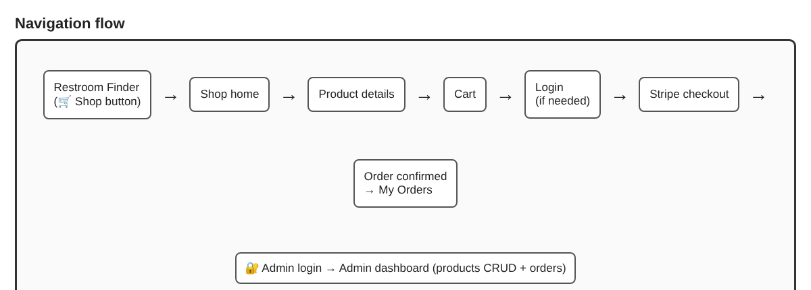
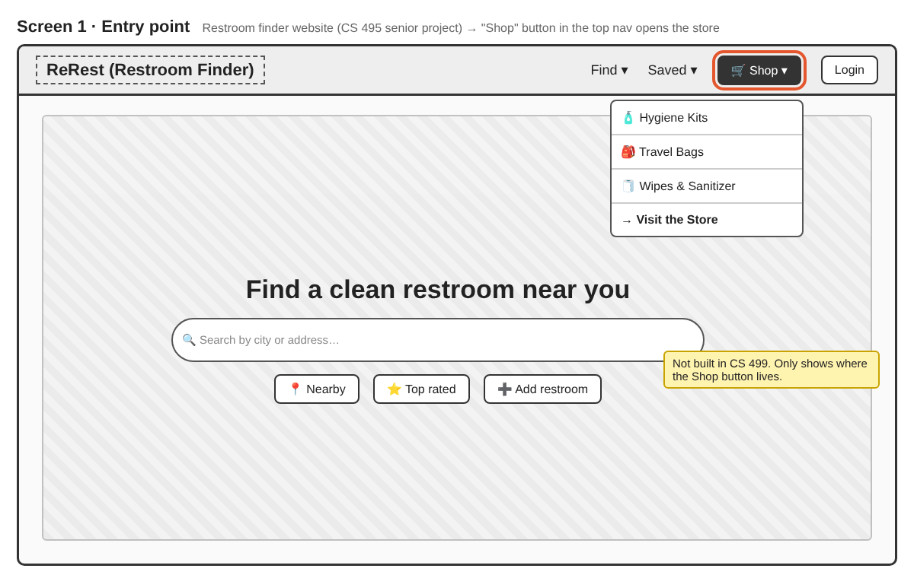
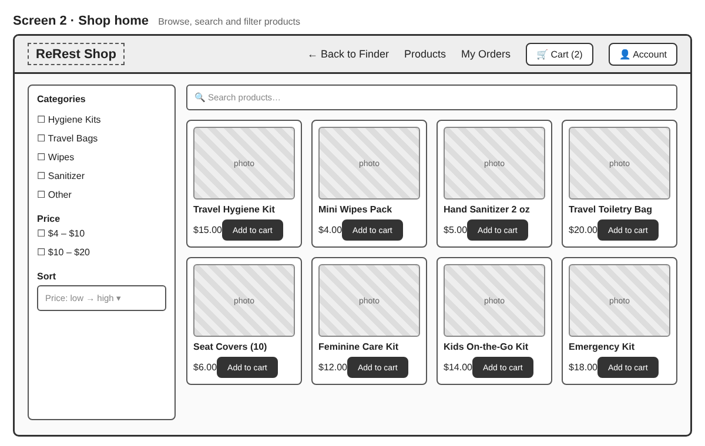
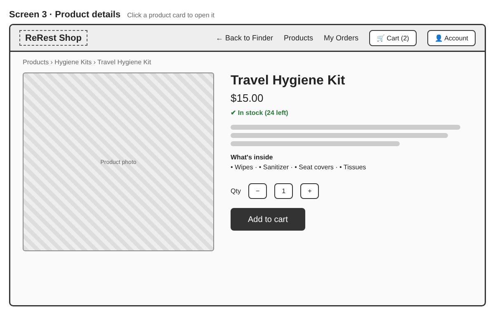
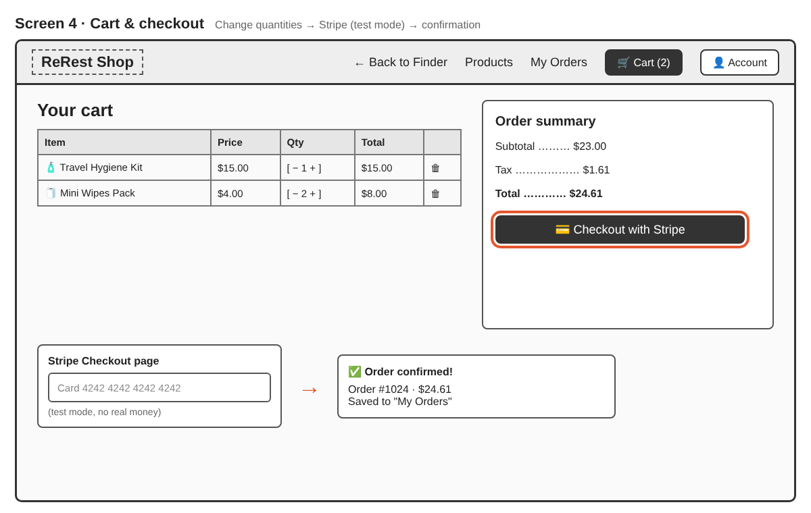
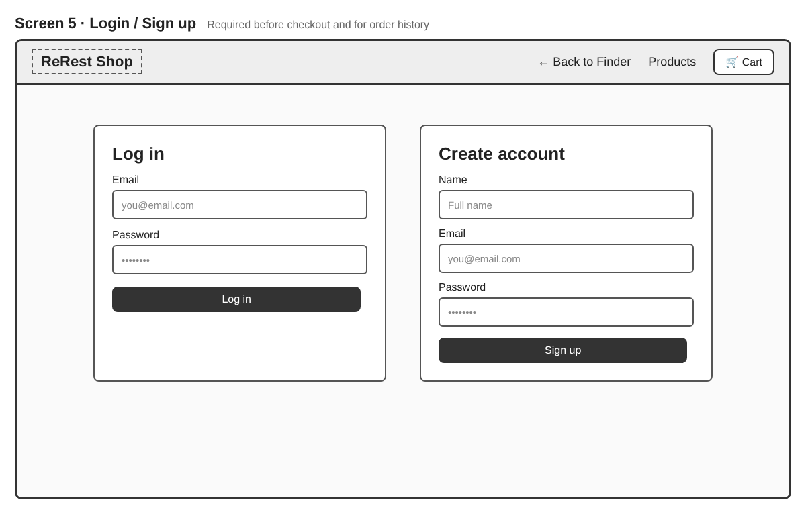
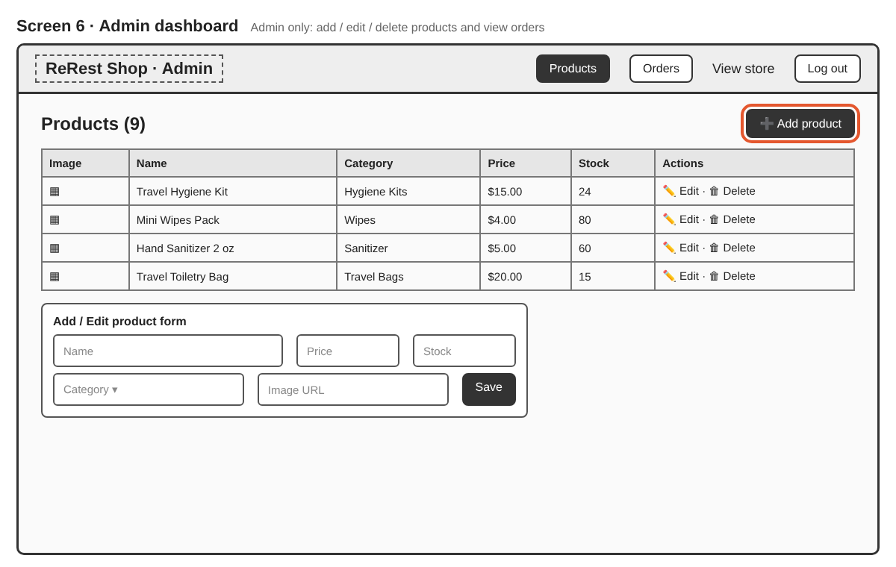

# ReRest Shop
CS-499 Project Milestone 1: Project Proposal & Initial Design

---

## <mark>1. Project Title</mark>
**ReRest Shop**: an e-commerce store for a restroom finder website.

---

## <mark>2. Project Description</mark>
ReRest Shop is an online store that sells hygiene and travel products such as hygiene kits, travel bags, wipes and hand sanitizer. Prices range from about $4 to $20. Users can create an account, browse and search the products, add items to a cart and pay online. After paying, they see an order confirmation and can check their past orders. An admin can add, edit and delete products and see all orders.

This store is part of a bigger website I am already building in my senior project class (**CS 495**). That website, **ReRest**, is a restroom finder: users can find nearby restrooms, see details, rate and review them, and add new ones. **For CS 499, I am only building the e-commerce store.** ReRest will have a **Shop button in the top menu** that takes users to the store, similar to the Shop menu on AllTrails.

The idea is simple: people looking for a restroom often don't have basic things with them, like wipes, sanitizer or seat covers. It can also be an emergency, like finding a restroom with no toilet paper or soap. A small kit that fits in your bag can really save you in these moments. ReRest Shop gives people one place to buy these kits and items so they are always ready when they are out.

---

## <mark>3. Target Users</mark>
The store is for everyone, but mainly:

| User | What they need |
|---|---|
| **Travelers and drivers** | Small kits and travel bags to keep in the car or carry-on |
| **People with special or health needs** | Easy access to seat covers, wipes and sanitizer when they are away from home |
| **People with hygiene preferences** | The products they like, all in one place |
| **Parents** | Ready kits for kids on the go |

Most users will come from the ReRest website, so they are already thinking about hygiene and being out of the house.

---

## <mark>4. Core Features</mark>
1. **Sign up and log in:** Users create an account and log in. An account is needed to check out and see past orders.
2. **Browse and search products:** Users see all products, search by name, filter by category and sort by price.
3. **Product details:** Users open a product to see its picture, price, description and stock.
4. **Shopping cart:** Users add items, change quantities, remove items and see the total.
5. **Checkout and order history:** Users pay with **Stripe (test mode)**, get an order confirmation and see their orders on a "My Orders" page.
6. **Admin page:** The admin can **add, edit and delete products** and **view all orders**.

---

## <mark>5. Project Scope</mark>
I think this project is a good size for 8 weeks because the store has a small number of products (7 to 10), one main user flow (browse, cart, pay) and one admin page. Each feature uses things we learn in this class: **React and JSX** for the pages, **fetch with a REST API** (GET, POST, PUT/PATCH, DELETE), **Node.js and Express** for the server and **PostgreSQL** for the database. Stripe handles the payment page, so I don't have to build card payments myself.

**Tools:** HTML, CSS, JavaScript, React (Vite), Node.js, Express, PostgreSQL, Git/GitHub and Stripe (test mode).

| Essential | Optional (if I have time) |
|---|---|
| Sign up and log in | Product reviews |
| Product list, search and filter | Discount codes |
| Product details page | Wishlist |
| Cart (add, update, remove) | Email receipts |
| Stripe checkout and order confirmation | Low stock alerts for the admin |
| My Orders page | |
| Admin: add, edit and delete products, view orders | |
| Shop button link from the ReRest website | |

**Challenges I expect:**
- **Stripe:** connecting the checkout and making sure the payment went through before saving the order.
- **Login and security:** hashing passwords and making sure only the admin can open the admin page.
- **Cart:** keeping the cart correct when the user changes quantities or refreshes the page.
- **Connecting everything:** getting React, Express and PostgreSQL to work together.

---

## <mark>6. Initial UI Sketch</mark>
All sketches are in the [`wireframes`](./wireframes) folder.

**Navigation flow**

**Screen 1: ReRest top menu with the Shop button**

**Screen 2: Shop home (browse, search, filter)**

**Screen 3: Product details**

**Screen 4: Cart and checkout**

**Screen 5: Log in and sign up**

**Screen 6: Admin page**

---

## <mark>7. Initial Data Requirements</mark>
| Data | What it stores |
|---|---|
| **Users** | Name, email, password (hashed), role (customer or admin) |
| **Categories** | Hygiene Kits, Travel Bags, Wipes, Sanitizer, Other |
| **Products** | Name, description, price, category, image, stock |
| **Cart Items** | User, product, quantity |
| **Orders** | User, date, total, status (pending, paid, shipped) |
| **Order Items** | Order, product, quantity, price when bought |
| **Payments** | Stripe session ID, amount, payment status |

**Example products:** Hygiene kits for men, women and kids (small and large), wipes and hand sanitizer. Prices range from about $4 to $20.
