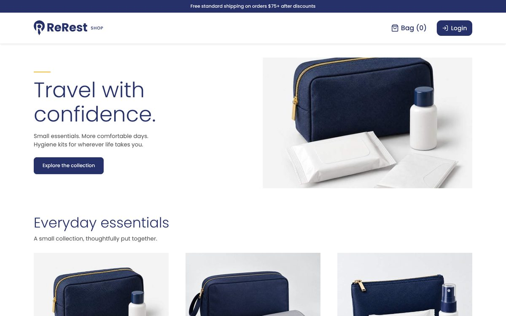
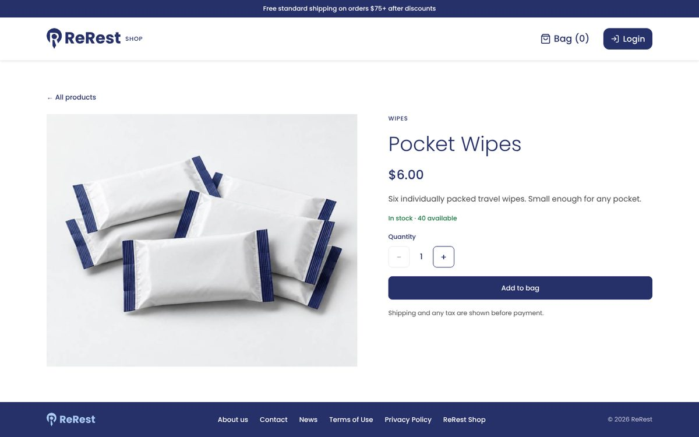
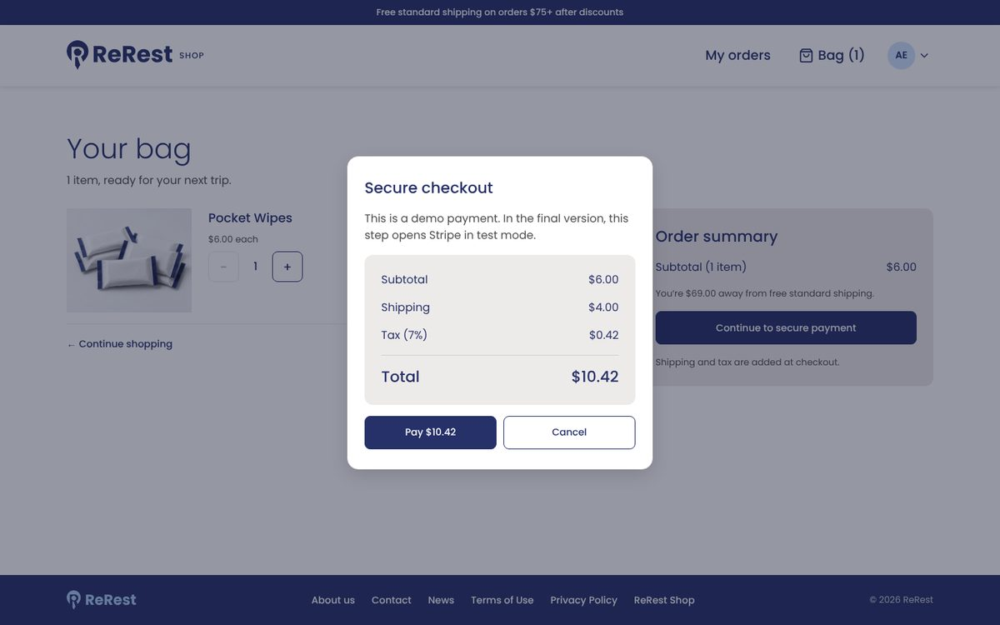
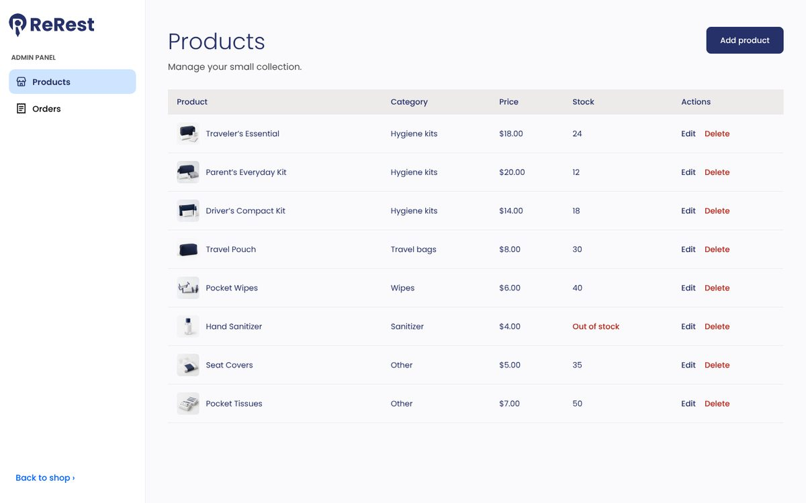

# ReRest Shop
CS-499 Project Milestone 2: React UI Prototype

**Live Prototype URL:** https://ue20.github.io/CS499-ReRest-Shop/

My Milestone 1 proposal and wireframes are in [`MILESTONE-1.md`](./MILESTONE-1.md) and the [`wireframes`](./wireframes) folder.

---

## <mark>1. About</mark>
ReRest Shop is the online store for **ReRest**, my restroom finder website. It sells hygiene kits, travel bags, wipes and sanitizer.

This milestone is the front end only. It is built with **React and Vite** and uses **mock data** in JavaScript files. There is no server yet, so changes reset when the page is refreshed.

---

## <mark>2. How to Run</mark>
You need Node.js.

```
npm install
npm run dev
```

Then open the link in the terminal.

| Command | What it does |
|---|---|
| `npm run dev` | Runs the site on my computer |
| `npm run build` | Makes the final site in `dist` |
| `npm run deploy` | Publishes the site to GitHub Pages |

---

## <mark>3. Demo Accounts</mark>
Sign-in is pretend for now. The sign-in page has buttons that fill these in.

| Role | Email | Password |
|---|---|---|
| Customer | abdo@example.com | shop123 |
| Admin | admin@rerests.com | admin123 |

---

## <mark>4. Screens</mark>
These follow my Milestone 1 wireframes.

| Milestone 1 wireframe | Page in the app |
|---|---|
| Shop home | Shop home + The collection (search, filter, sort) |
| Product details | Product page |
| Cart and checkout | Your bag + checkout pop-up + order confirmation |
| Log in and sign up | Sign in |
| Admin page | Products, Add/Edit product, Orders |
| My Orders | My orders + Order details |

Screen 1 (the Shop button in the ReRest menu) belongs to the main ReRest website.

| Shop home | Product page |
|---|---|
|  |  |

| Bag and checkout | Admin products |
|---|---|
|  |  |

---

## <mark>5. Components</mark>
| Folder | What is inside |
|---|---|
| `src/App.jsx` | Keeps the shared state (page, bag, user, products, orders) and shows one page at a time |
| `src/components` | Small parts used on many pages: Header, Footer, ProductCard, CategoryFilter, QuantityStepper, Modal and more |
| `src/pages` | One file for each screen (Home, Catalog, Product, Bag, Sign in, My orders) |
| `src/pages/admin` | The admin screens (Products, Product form, Orders, Order) |

---

## <mark>6. Mock Data</mark>
| File | What it has |
|---|---|
| `src/data/products.js` | 8 products: name, category, price, stock, image, description |
| `src/data/orders.js` | 3 orders: customer, items, status (pending, paid, shipped) |
| `src/data/users.js` | 2 demo accounts: customer and admin |
| `src/utils/price.js` | Price helpers: subtotal, shipping and 7% tax |

---

## <mark>7. Next Milestones</mark>
Express API, PostgreSQL database, real sign-in with hashed passwords, and Stripe checkout in test mode.
